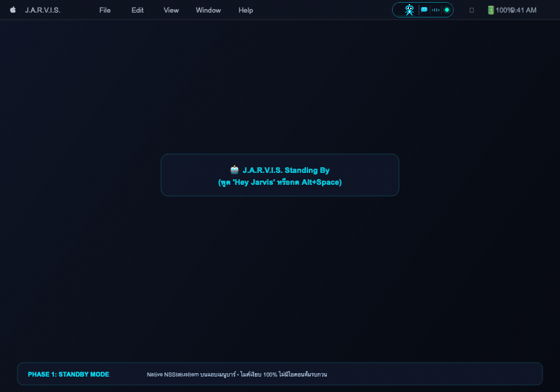
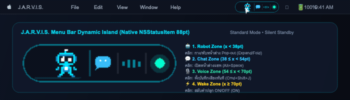
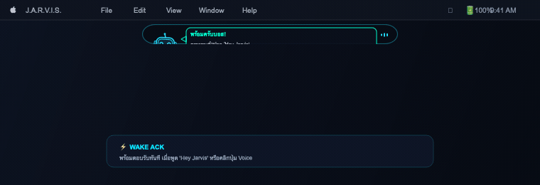

# J.A.R.V.I.S. JR. // K.A.R.I.S. 🚀
*(Kinetic Autonomous Responsive Intelligent Sidekick — Release v2.0.0)*

[](https://github.com/Tanachai015/Karis-JarvisJr/tree/v2.0.0)
[-blue?logo=apple)](https://www.apple.com/macos/)
[](https://www.python.org/)
[-41CD52?logo=qt)](https://www.qt.io/)
[](https://aistudio.google.com/)
[-8B5CF6)](https://modelcontextprotocol.io/)
[%20%2B%20Whisper-F55036)](https://groq.com/)
[-success)](tests/run_backtest.py)
[](LICENSE)

An agentic, event-driven, multimodal AI desktop companion built natively for macOS. Meet **J.A.R.V.I.S. JR. (aka K.A.R.I.S.)** — the high-energy, agile, sidekick dedicated to **บอสคิม (Boss Kim)**. Powered by **Google GenAI SDK (Gemini)**, **Official Model Context Protocol (MCP)**, **Low-Poly Faceted Vector Avatar (`QPainter` / `QPolygonF`)**, **Smart Ambiguity Confirmation Loop**, **Owner Approval Gate**, **Single-Screen State Guard**, and **Active-Screen Overlay Chat**.

---

## 🎬 System Showcase



---

## 🌟 Key Features & Engineering Highlights (v2.0.0)

### 1. 🤖 Low-Poly Faceted Cyber Avatar & Dynamic Island
- **Pure Vector Polygon Graphics (`QPainter` / `QPolygonF` 100%):** Zero external images or raster files. Features a 3D faceted polygon head, hexagonal dark visor, prism ears, crystal diamond antenna tip, and wireframe mesh torso with cyan vertex nodes.
- **Dynamic 3D Shading on Head Tilt:** Real-time lighting gradient (`#051624` to `#0E3A5D`) dynamically shifts across head polygons based on kinematics `head_tilt`.
- **Single-Screen State Guard:** When expanding during speech, voice recording, or hotkey triggers (`Cmd+Shift+J`), the island dynamically activates **only on the active monitor** hosting `QCursor.pos()`, keeping other screens completely hidden.

### 2. 🛡️ Smart Ambiguity Confirmation Loop
- **Durable Turn-Based State (`memory/workflow_state.json`):** Safely tracks ambiguous intents across user turns without state loss.
- **Strict 3-Step Confirmation Flow:**
  1. **Garble Interception:** Never repeats or articulates corrupted speech. Asks cleanly for the inferred intent (e.g. *"คำสั่งไม่ค่อยชัดเจนครับ บอสคิมหมายถึง 'เปิด Terminal' ใช่ไหมครับ?"*).
  2. **Affirmation (`ใช่ / ถูกต้อง`):** Directly executes the inferred action without redundant questions.
  3. **Denial (`ไม่ใช่ / ผิด`):** Explicitly quotes back the raw speech heard so the owner knows what was misrecognized.

### 3. 🔐 Owner Approval Gate
- **High-Impact Tool Interception:** Automatically halts dangerous actions (`git_commit`, `git_reset`, write/edit operations outside memory/tests) before execution.
- **Native Dynamic Island Buttons:** Automatically expands the island displaying interactive `[✓ Approve]` (#00FFD1) and `[✕ Reject]` (#FB7185) buttons.
- **Safe Fallback:** If rejected by the owner, execution cleanly aborts and logs the cancellation safely.

### 4. 🏝️ True Native macOS `NSStatusItem` Dynamic Island
- **Native Menu Bar Embedding:** Uses `AppKit.NSStatusBar` (`88.0pt`) as a first-class citizen across all displays and virtual spaces. Automatically avoids macOS camera notch and microphone privacy indicators without window overlapping.
- **Chill Pixel Life Engine:** 14×16 px vector/pixel mascot featuring 13 idle activities (walking, coffee break, typing, nap, peek) with 4-bar reactive equalizer.
- **4 Interactive Click Zones (Zero Redundant Tray):**
  - `🤖 Robot Zone (x < 38pt)`: Left-click toggles expanding/folding the Dynamic Island Pop-out window.
  - `💬 Chat Zone (38 ≤ x < 54pt)`: Left-click opens Overlay Chat (`Alt+Space`).
  - `🎙️ Voice Zone (54 ≤ x < 70pt)`: Left-click initiates instant voice recording (`Cmd+Shift+J`).
  - `⚡ Wake Zone (x ≥ 70pt)`: Left-click toggles Wake Word trigger (*"Hey Jarvis"*) ON/OFF with live LED feedback.

| Menu Bar Standby & Quick Actions | Dynamic Island Spring Pop-out |
| :---: | :---: |
|  |  |

### 5. 🛑 Instant `Esc` Voice Cancellation & Zero Data Transmission
- **Pure Silent Cancel (Keycode 53):** Pressing `Esc` while recording immediately cancels the session via `cancel_listening_direct()`.
- **100% Data Discard:** Immediately purges `recorded_chunks` and drains the audio queue. Zero STT transcription, zero Cloud/LLM API calls.
- **Mic Hardware Release:** Shuts down CoreAudio stream and turns off the macOS orange microphone indicator instantly, returning cleanly to silent standby.

### 6. 🖥️ Active-Screen Overlay Chat (`Alt + Space`)
- **Multi-Monitor Cursor Tracking:** Detects active mouse location via `QGuiApplication.screenAt(QCursor.pos())` and centers the Spotlight HUD on the current monitor.
- **K.A.R.I.S. Persona & Dialogue:** Assistant bubble branding updated to `Karis:` with clear Thai conversational styling.
- **Dual-Tab Interface:**
  - **Conversation Tab:** Clean, markdown-formatted dialogue with Thai typography.
  - **Process & Raw Data Tab:** Real-time MCP tool logs and background task execution history.

### 6. 🧠 4-Tier Cognitive Context & Official MCP Ecosystem (31 Tools)
- **Tiered Memory:** `L0: Soul Core` (Personality) ➔ `L1: User Facts` ➔ `L2: Events` ➔ `L3: Active Chat`.
- **Official MCP Servers (Stdio):**
  - `@modelcontextprotocol/server-filesystem` (16 tools)
  - `mcp-server-fetch` (1 tool)
  - `mcp-server-git` (14 tools)
  - Native macOS Tools: Vision GUI click, Clipboard injection, System Control, Antigravity Bridge.
- **Persistent Schema Cache:** Boots all 31+ tools in **0.005s** via SHA-256 disk cache.

---

## ⌨️ Global Shortcuts & Controls

| Action | Shortcut / Trigger | Description |
| :--- | :--- | :--- |
| **Toggle Chat HUD** | `Alt + Space` | Open/hide Spotlight chat window centered on active screen |
| **Toggle Voice Mic** | `Cmd + Shift + J` | Press to start speaking, press again to send |
| **Cancel Voice (Esc)** | `Escape` *(while listening)* | Cancel recording, discard all audio 100%, and return to silent standby |
| **Barge-in Interrupt** | `Escape` *(while speaking)* | Immediately cut speaker output, play "Ok ครับ", and open mic |
| **Wake Word Trigger** | *"Hey Jarvis"* | Hands-free edge wake word detection via OpenWakeWord ONNX |
| **Menu Bar Quick Actions** | Click 88pt Status Item | Click Robot (Pop-out), Chat (HUD), Voice (Record), Wake (Toggle ON/OFF) |
| **Context Menu** | Right-Click Status Item | Cyber context menu for settings, history clearing, and exit |

---

## 🏛️ System Data Flow

```text
[User Trigger: Cmd+Shift+J (PTT)  |  "Hey Jarvis"  |  Menu Bar Island Click]
                               │
                               ▼
        [JarvisListener Single-Pipeline (voice/listener.py)]
                               │
        ┌──────────────────────┴──────────────────────┐
        ▼                                             ▼
 [Esc Cancel Keycode 53]                    [Active Voice Capture]
 - cancel_listening_direct()                - Silero VAD neural filter
 - Discard 100% audio chunks                - 3.0s silence auto-cutoff
 - Teardown CoreAudio stream                - Groq Cloud STT (~0.2s)
 - Return to silent Standby                           │
                                                      ▼
                                       [JarvisBrain (core/brain.py)]
                                                      │
                       ┌──────────────────────────────┴──────────────────────────────┐
                       ▼                                                             ▼
             [4-Tier Context Engine]                                       [31 MCP & Native Tools]
             - L0: soul_core.md (Candor)                                   - Filesystem MCP (16 tools)
             - L1: jarvis_memory.json                                      - Web Fetch MCP (1 tool)
             - L2: events.jsonl                                            - Git MCP (14 tools)
             - L3: chat_history.json                                       - macOS Vision, Mouse, Keyboard
                       │                                                             │
                       └──────────────────────────────┬──────────────────────────────┘
                                                      ▼
                                            [Dual-Output Protocol]
                                                      │
                       ┌──────────────────────────────┴──────────────────────────────┐
                       ▼                                                             ▼
              [Visual HUD Display]                                         [Bilingual Neural Voice]
              OverlayChat Window                                           Microsoft Edge-TTS
              (Active Screen Center,                                       - Dual-tone TH/EN
               Dual-Tab Chat & Process)                                    - Instant Afplay (0ms)
```

---

## 📂 Project Directory Structure

```text
Javis Project/
├── .env                              # API keys & configuration (Git-ignored)
├── config.py                         # Runtime constants & system thresholds
├── main.py                           # App lifecycle & Quartz EventTap interceptor
├── voice_settings.json               # Voice gain & VAD parameters
├── mcp_servers.json                  # Official MCP server configurations
├── PROJECT_ARCHITECTURE.md           # Full architectural manual (Release v1.9.4)
├── README.md                         # Project documentation & showcases
│
├── previews/                         # UI Demonstration Animated GIFs
│   ├── 01_menubar_standby.gif        # Standby menu bar & 4 quick actions
│   ├── 02_dynamic_island_popout.gif  # Spring pop-out & 60 FPS vector states
│   ├── 03_overlay_chat.gif           # Active-screen chat & process tab
│   ├── 04_jarvis_showcase.gif        # Complete end-to-end showcase
│   └── generate_all_previews.py      # Automated preview generator
│
├── tests/                            # Automated Testing Suite
│   └── run_backtest.py               # 36-case offline backtest suite (100% PASS)
│
├── core/                             # Core System Modules
│   ├── event_bus.py                  # Thread-safe PySide6 signal bus
│   ├── brain.py                      # Gemini LLM processor & 4-tier context
│   ├── tools.py                      # Native macOS Vision, Mouse, & Keyboard
│   ├── thai_nlp.py                   # PyThaiNLP & RapidFuzz phonetic matcher
│   ├── task_manager.py               # Background task registry & reveal
│   ├── raw_archive.py                # 365-day partitioned JSONL storage
│   └── mcp_manager.py                # MCP client & schema disk cache
│
├── voice/                            # Audio Pipeline
│   ├── listener.py                   # Single-Pipeline STT, VAD, & Esc Cancel
│   └── speaker.py                    # Edge-TTS dual-tone speech synthesizer
│
├── ui/                               # PySide6 Presentation Layer
│   ├── dynamic_island.py             # True Native NSStatusItem & Pop-out HUD
│   ├── overlay_chat.py               # Active-screen Spotlight-style chat
│   ├── pixel_engine.py               # Chill Pixel Life engine & vector renderer
│   └── pixel_sprites.py              # 14x16 pixel robot avatar bitmaps
│
└── memory/                           # Persistent Storage (Git-ignored)
    ├── soul_core.md                  # L0 Personality core
    ├── jarvis_memory.json            # L1 Confirmed facts
    ├── events.jsonl                  # L2 Context events
    └── chat_history.json             # L3 Conversation turns
```

---

## ⚡ Quickstart & Installation

### 1. Setup Environment
```bash
git clone https://github.com/Tanachai015/Jarvis-AIsis.git
cd "Jarvis-AIsis"

# Create virtual environment
python3 -m venv .venv
source .venv/bin/activate

# Install dependencies
pip install -r requirements.txt
```

### 2. Configure Environment (`.env`)
```bash
cp .env.example .env
```
Fill in your keys:
```ini
GEMINI_API_KEY=AIzaSy...
GROQ_API_KEY=gsk_...
STT_MODE=groq
WAKE_TRIGGER_ENABLED=false   # Standard Mode: silent mic standby
```

### 3. Verify System Integrity (Automated Backtest)
```bash
python3 tests/run_backtest.py
```
*Outputs: `ALL 36 TESTS PASSED (100% Success Rate)` in ~5.5s.*

### 4. Launch Jarvis
```bash
python3 main.py
```

---

## 🔒 Required macOS Permissions
1. **Accessibility (`AXIsProcessTrustedWithOptions`)**: Required for Quartz EventTap (`Cmd+Shift+J`, `Alt+Space`, `Esc`) and Vision mouse control.
2. **Microphone**: Required for `voice/listener.py` voice input.
3. **Screen Recording**: Required for `screencapture -x` Vision GUI automation.

---

## 🧪 Automated Testing Suite (36/36 PASS)

The test suite runs **100% offline with zero token cost** via `tests/run_backtest.py`:
- **Suite 1: Thai NLP & Matching Engine (5/5 PASS):** Pacing, Thai currency translation, Soundex matching.
- **Suite 2: Voice Engine & State Transitions (12/12 PASS):** PTT cycles, Esc cancellation, Silero VAD cutoff.
- **Suite 3: Brain Context & OS Sandbox (6/6 PASS):** Tiered context assembly, deduplication guard, file-bridge.
- **Suite 4: System Integrity & GUI Validation (13/13 PASS):** Native `NSStatusItem` 88pt, Menu Bar quick actions, Active-screen chat detection, 60 FPS vector robot zero-crash.

---

## 📄 License

This project is licensed under the [MIT License](LICENSE).
